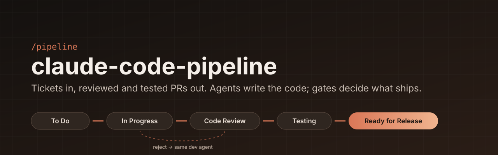
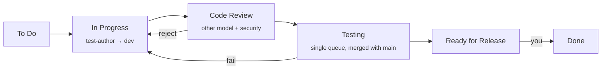

<p align="center">
  
</p>

<p align="center">
  <a href="LICENSE"></a>
  
  
  
  <a href="https://github.com/Iremir0/shipgate/actions/workflows/ci.yml"></a>
</p>

<p align="center"><b>A gated, multi-agent delivery pipeline for <a href="https://docs.claude.com/en/docs/claude-code">Claude Code</a>.</b><br>
You write tickets and release. Agents write tests, code and reviews. Gates decide what ships.</p>

<p align="center"><a href="README.tr.md">Türkçe</a> · <a href="docs/how-it-works.md">How it works</a> · <a href="https://github.com/Iremir0/shipgate-demo">Demo repo</a> · <a href="docs/case-study.md">Case study</a></p>

---

## Why

Letting one AI session "just build the feature" works until it doesn't: it edits the test to make it pass, reviews
its own blind spots, and calls something done that was never run against the real services.

This plugin is the process I use on a production e-commerce codebase instead. The main Claude Code session becomes a
**manager that is not allowed to write code**. It moves each ticket across a kanban board and hands the work to
specialised agents, and a ticket only moves forward when a gate is passed with evidence.

## The pipeline



| Gate | Rule | Why |
|---|---|---|
| 🔒 **Locked tests** | Failing tests are written first, in their own commit. The dev agent may not touch them; the reviewer diffs them and auto-rejects any change. | The agent can't "fix" the test instead of the code. |
| 🔀 **Cross-model review** | Sonnet's code is reviewed by Opus and vice versa. A forced same-model review is stamped ⚠️ on the PR. | A model approves its own mistakes. |
| 🛡️ **Risk routing** | Money, payments, auth, migrations → stronger dev, mandatory test-first, security review (Critical/High = reject). | Spend the expensive checks where mistakes are expensive. |
| 🧪 **Single testing queue** | One ticket at a time, merged with the latest `main`, every relevant suite incl. e2e against real services. | Shared DBs and ports; two green branches can be red together. |
| ⛔ **BLOCKED ≠ PASS** | A suite that couldn't run never counts as passed. | No "tests skipped, looks good". |
| 🔁 **Loop limit** | 3 rejects + fails → `blocked`, human looks. | Stops agents from grinding on a bad ticket. |
| 🙋 **Humans release** | The pipeline stops at *Ready for Release* with a release note and a pipeline log. | You stay accountable for what ships. |

More detail and the reasoning behind each rule: **[docs/how-it-works.md](docs/how-it-works.md)**.

## Try it in 5 minutes

The **[demo repo](https://github.com/Iremir0/shipgate-demo)** is a tiny cart calculator with three seeded
issues: a copy change, a risky money feature and a planted bug.

```bash
gh repo create my-pipeline-demo --template Iremir0/shipgate-demo --private --clone
cd my-pipeline-demo && npm ci && npm run seed
claude          # trust the folder, accept the plugin install
> /pipeline
```

Watch the issues move across `status:*` labels, with plans, review decisions and release notes as comments and one
merged PR per issue. A real run is recorded in **[docs/example-run.md](docs/example-run.md)**.

## Use it in your repo

```text
/plugin marketplace add Iremir0/shipgate
/plugin install shipgate@shipgate
/pipeline-init            # detects your stack, writes .claude/pipeline.json, sets up the tracker
/new-ticket add refund requests
/pipeline                 # work the whole board
/pipeline #12             # or one ticket
```

| Command / agent | What it does |
|---|---|
| `/pipeline [key]` | The manager. Board mode or a single ticket. |
| `/new-ticket <idea>` | Drafts a ticket with testable Given/When/Then criteria, test plan, out-of-scope and security notes; creates it after you approve. |
| `/pipeline-init` | One-time setup per repo. |
| `test-author`, `dev-standard`, `dev-critical`, `code-reviewer`, `security-reviewer`, `test-runner` | The agents ([agents/](agents)). |
| Stop hook | Runs your quick checks on changed files before Claude may end a turn. |

Configuration reference: **[docs/configuration.md](docs/configuration.md)** · Trackers: **[docs/trackers.md](docs/trackers.md)**

## In production

I run this pipeline on a production e-commerce monorepo (Medusa 2 + Next.js 16 + Expo, Jira kanban) where prices follow
the live gold price, so most work touches money, stock or payments. First three weeks:

| 30 | 76 % | 81.5 % | 3 |
|:---:|:---:|:---:|:---:|
| tickets delivered | approved on first cross-model review | passed first test run against `main` + real services | test runs reported **BLOCKED** instead of a fake pass |

One ticket in four was sent back by the reviewer and one in five failed integration before any human saw it.

The full story, including what went wrong and what changed because of it: **[docs/case-study.md](docs/case-study.md)**.

## FAQ

**Isn't this expensive?** Cheap work stays cheap: copy and small changes go to Sonnet and may skip test-first. Opus is
spent on risky code and on reviewing Sonnet. The pipeline log on every ticket tells you where the tokens went.

**Can it merge to my main branch by itself?** By default yes, after review *and* testing pass; it never pushes to
`main` directly. Set `"autoMerge": false` to stop at an approved, tested PR.

**What does it ask me?** Only real decisions: a new module or data model, where data lives, a new dependency, a
customer-visible rule with several reasonable answers. Everything else it decides and records on the ticket.

**Does it work without Docker / integration tests?** Yes. `commands.suites` is optional; the demo has none.

## Roadmap
- Linear and GitHub Projects (v2) status fields as trackers
- Cost per ticket in the pipeline log
- A `/pipeline-report` command that charts reject/fail rates per model over time

## License
MIT © Emir Tüfekci
