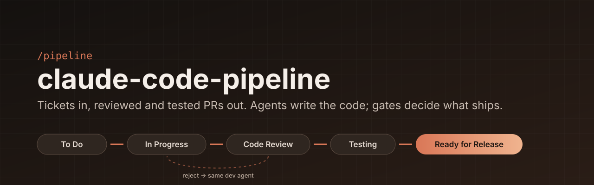
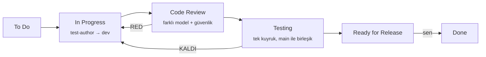

<p align="center">
  
</p>

<p align="center"><b>Claude Code için kapılı (gated), çok agent'lı teslimat hattı.</b><br>
Sen kart yazar ve release edersin. Agent'lar test, kod ve inceleme yazar. Neyin çıkacağına kapılar karar verir.</p>

<p align="center"><a href="README.md">English</a> · <a href="docs/how-it-works.md">Nasıl çalışır</a> · <a href="https://github.com/Iremir0/shipgate-demo">Demo repo</a> · <a href="docs/case-study.md">Vaka çalışması</a></p>

---

## Neden

Tek bir AI oturumuna "özelliği yap" demek bir noktaya kadar işe yarar. Sonra testi geçsin diye testi değiştirir, kendi
kör noktalarını kendisi onaylar ve gerçek servislerde hiç çalışmamış bir şeye "bitti" der.

Bu plugin, canlıdaki bir e-ticaret projesinde bunun yerine kullandığım süreç. Ana Claude Code oturumu **kod yazması
yasak bir yöneticiye** dönüşür. Her kartı kanban board'unda ilerletir, işi uzman agent'lara dağıtır. Kart ancak bir
kapıyı kanıtla geçtiğinde ilerler.

## Hat



| Kapı | Kural | Neden |
|---|---|---|
| 🔒 **Kilitli testler** | Başarısız testler önce, ayrı bir commit'te yazılır. Dev agent onlara dokunamaz; reviewer diff'ler ve değişikliği otomatik reddeder. | Agent kodu değil testi "düzeltemez". |
| 🔀 **Farklı modelle inceleme** | Sonnet'in kodunu Opus inceler, tersi de geçerli. Zorunlu aynı-model incelemesi PR'da ⚠️ ile işaretlenir. | Model kendi hatasını onaylar. |
| 🛡️ **Risk yönlendirme** | Para, ödeme, yetki, migration → güçlü dev, zorunlu test-first, güvenlik incelemesi (Kritik/Yüksek = RED). | Pahalı kontrol, hatanın pahalı olduğu yere. |
| 🧪 **Tek test kuyruğu** | Aynı anda bir kart; en güncel `main` ile birleşik, gerçek servislerle bütün ilgili testler (e2e dahil). | Ortak DB ve portlar; tek tek yeşil iki branch birlikte kırmızı olabilir. |
| ⛔ **ENGELLENDİ ≠ GEÇTİ** | Çalıştırılamayan test asla geçti sayılmaz. | "Testler atlandı, iyi görünüyor" yok. |
| 🔁 **Döngü sınırı** | 3 RED + KALDI → `blocked`, insan bakar. | Agent'ın kötü bir kart üzerinde dönmesini durdurur. |
| 🙋 **Release insanındır** | Hat *Ready for Release*'te durur; sürüm notu ve hat kaydıyla. | Neyin çıktığından sen sorumlu kalırsın. |

## 5 dakikada dene

```bash
gh repo create my-pipeline-demo --template Iremir0/shipgate-demo --private --clone
cd my-pipeline-demo && npm ci && npm run seed
claude          # klasöre güven, plugin kurulumunu kabul et
> /pipeline
```

## Kendi repo'nda kullan

```text
/plugin marketplace add Iremir0/shipgate
/plugin install shipgate@shipgate
/plugin install shipgate-hooks@shipgate   # isteğe bağlı Stop hook
/pipeline-init
/new-ticket iade talebi ekle
/pipeline
```

## Canlıda

Canlı altın fiyatına bağlı fiyatlanan bir takı e-ticaret monorepo'sunda (Medusa 2 + Next.js 16 + Expo, Jira kanban)
ilk üç hafta: **30** kart teslim edildi, **%76**'sı ilk farklı-model incelemesinde onaylandı, **%81,5**'i `main` ve
gerçek servislerle ilk test koşusunu geçti, **3** test koşusu sahte bir "geçti" yerine **ENGELLENDİ** olarak raporlandı.
Ayrıntı: [docs/case-study.md](docs/case-study.md).

## Lisans
MIT © Emir Tüfekci
