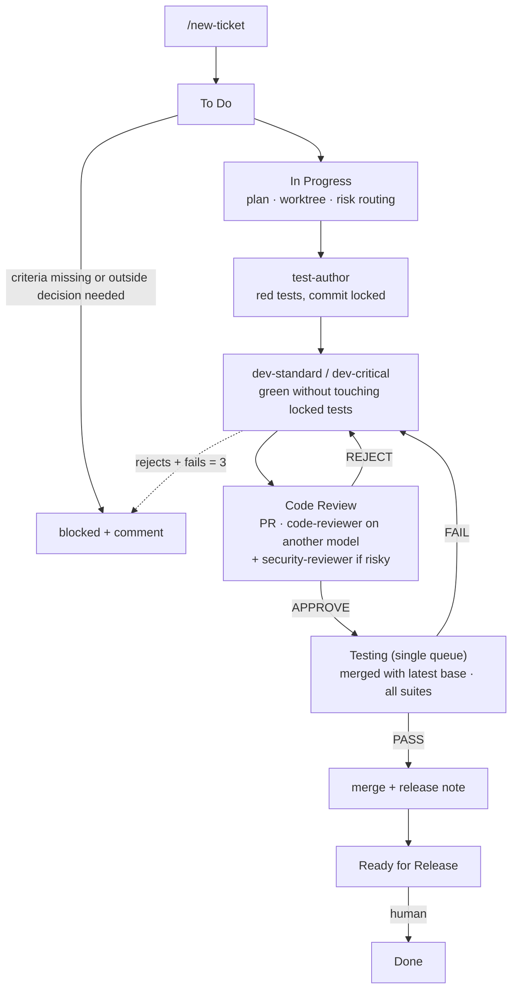

# How it works

`/pipeline` turns the main Claude Code session into a **manager that writes no code**. It reads tickets, plans,
assigns specialised agents, enforces gates and does the git, PR and tracker work. Agents do the engineering.

## Roles

| Role | Who | Responsibility |
|---|---|---|
| Product owner / architect | **You** | Priorities and business decisions; answers the architecture questions the pipeline asks; releases what is in *Ready for Release* |
| Manager | main session (`/pipeline`) | Plans, routes, enforces gates; git, PRs, merges, tracker |
| Test author | `test-author` (Opus) | Writes **failing** tests from the acceptance criteria before any code exists |
| Developer | `dev-standard` (Sonnet) / `dev-critical` (Opus) | Makes the locked tests pass **without touching them**; updates docs |
| Code reviewer | `code-reviewer` (a **different model** from the dev) | Acceptance, correctness, test integrity → APPROVE / REJECT |
| Security reviewer | `security-reviewer` (Opus) | Runs on risky tickets; Critical/High = REJECT |
| Test runner | `test-runner` (Sonnet) | Runs everything against the latest base branch, with real services → PASS / FAIL / BLOCKED |

## Stages and gates

### Why each rule exists

**Locked tests.** The test author commits failing tests in their own commit. The reviewer checks
`git diff <test-sha>..HEAD -- <locked files>` and rejects automatically if a locked test was edited, skipped or
loosened. Without this, an agent under pressure "fixes" the test instead of the code. If the dev agent thinks a test is
wrong it must argue it; the manager decides and the test author fixes it.

**A different model reviews.** The same model shares its own blind spots: it tends to approve exactly the mistakes it
would make. Sonnet's code is reviewed by Opus and vice versa. If only one model is available the pipeline still runs
but stamps **⚠️ same-model review** on the PR and the release note, so the weaker gate is visible, not silent.

**Risk routing.** Work that touches `risk.paths` or mentions `risk.keywords` (money, payments, auth, migrations...)
goes to the stronger developer, can never skip test-first, and gets a security review. Everything else stays cheap.

**One ticket in Testing at a time.** Integration and e2e suites share a database, ports and services; two tickets
tested at once corrupt each other's data. Development and review run up to `parallel` tickets; Testing is a queue.

**Test the merge, not the branch.** The runner merges the latest base branch first. Two tickets that are each green
can be red together; this is where that is caught. If the base moved after testing, testing runs again before merge.

**BLOCKED is not PASS.** A suite that could not run (Docker down, port busy) never counts as passed. The ticket waits.

**Same agent for rework.** Review findings and test failures go back to the agent that wrote the code
(`SendMessage`), which still has the context, instead of a fresh agent that would re-read everything.

**Loop limit.** After `loopLimit` (3) review rejects + test failures the ticket is stopped and labelled `blocked` with
a summary. Something is wrong with the ticket or the approach, and a human should look.

**Humans release.** The pipeline stops at *Ready for Release*. Each ticket arrives with a release note: what changed,
PR and merge SHA, release requirements (migrations, env vars, restarts), the test table, optional manual checks and a
**pipeline log** (models used, reject/fail counts) that you can use to tune which work goes to which model.

**Ask only real decisions.** The manager does not ask "shall I continue?". It asks only about new modules or data
models, where data lives, new dependencies, and customer-visible business rules with several reasonable answers.

## The Stop hook

Before Claude ends any turn, `hooks/verify-on-stop.mjs` looks at uncommitted files, runs the commands that
`verifyOnStop` maps to them, and **blocks the turn** with the failing output if one fails. Results are cached by a
fingerprint of the relevant files, and an unchanged failure is not re-blocked in a loop. Disable for a session with
`PIPELINE_SKIP_VERIFY=1`.
